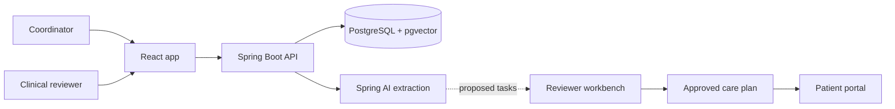

# CareBridge

**Post-discharge care coordination.** CareBridge gives discharge coordinators one workspace to assemble a follow-up plan, assign tasks, and turn complex discharge text into a clear checklist that a clinician reviews before anyone else sees it.

> **Status:** early development, following an 8-week roadmap (see below). CareBridge is educational coordination software that uses **synthetic patients only**. It is not a clinical decision support tool, an EHR integration, or a certified or HIPAA-compliant product.

## The problem

After a patient leaves the hospital, the practical follow-up work is scattered across email and spreadsheets:

- booking follow-up visits
- arranging transport
- clarifying the medication list
- keeping family and caregivers informed

CareBridge brings this into one plan with clear task owners. AI helps pull action items out of discharge text, but a clinical reviewer approves every item first. It never diagnoses, triages or changes medications.

## Who it's for

- **Discharge coordinators:** own the plan and assign tasks
- **Clinical reviewers:** approve or correct AI-proposed tasks and summaries
- **Patients and caregivers (demo):** see only approved tasks
- **System admins:** manage configuration and the audit trail

## Demo workflow

1. Open synthetic patient "Case 008"
2. Upload invented discharge text
3. Watch proposed tasks appear, each with its source excerpt
4. A reviewer approves "schedule follow-up by Friday" and corrects one due date
5. The coordinator assigns transport to a staff member
6. The patient portal shows only the approved tasks
7. The audit timeline records every step

## Planned features

- Synthetic patient case registry
- Discharge document upload with source tracking
- Care plans with task assignments and owners
- AI extraction of follow-up actions as *proposed* tasks, linked to source text
- Reviewer workbench to approve, correct or reject each item
- Plain-language summaries generated only from approved facts
- Flags for missing details, such as a follow-up with no date
- Patient and caregiver portal showing only approved tasks
- Optional FHIR adapters using synthetic fixtures
- Full audit trail of task changes

## Tech stack

| Layer | Technology |
|---|---|
| Frontend | React, TypeScript |
| Backend | Java, Spring Boot, Spring Security, Spring Data JPA |
| AI integration | Spring AI |
| Database | PostgreSQL with pgvector |
| Cache | Redis |
| Interoperability | Optional FHIR fixture adapters |
| Local environment | Docker Compose |

## Architecture



## Design rules

- No AI-generated content reaches a patient-facing plan without approval.
- Every approved fact links back to its source text.
- Every task change is audited.
- Patients can never see another patient's data.
- No diagnoses, triage or medication changes, ever.
- No real patient data or PHI in any public instance.

## Roadmap

| Week | Focus | Status |
|---|---|---|
| Week 1 | **Research, design & local bootstrap** — Add care-coordination design docs and React app shell, bootstrap Spring Boot API with health, OpenAPI, Flyway and Compose | ✅ Done |
| Week 2 | **Identity, roles & assignment policy** — Add care-unit memberships, roles and Spring Security sessions, add React sign-in, role-aware navigation and case-assignment checks | Planned |
| Week 3 | **Case registry & document ingestion** — Add synthetic patients, discharge cases and versioned case endpoints, add versioned source documents with content hashes and size limits, add upload and side-by-side preview UI | Planned |
| Week 4 | **Care plans & assignments** — Add plan tasks, assignments and approval entities, add transactional plan publishing with reviewer guard | Planned |
| Week 5 | **AI extraction & reviewer workbench** — Add structured extraction contract with mock provider, add proposal review state machine with edit diffs, add reviewer queue with source highlights | Planned |
| Week 6 | **Patient portal & staging** — Link patient-demo accounts to published cases, add mobile-first patient task view with demo warning | Planned |
| Week 7 | **Approved-plan summaries & interoperability** — Add versioned summaries generated from approved plans, add synthetic FHIR Patient, Encounter and Task mapping, add coordinator reporting dashboard and export | Planned |
| Week 8 | **Security, resilience & release** — Audit team and case authorization end to end, add access abuse tests and dependency scans, freeze v1 acceptance scope and write release notes, ship synthetic-only demo with mock model | Planned |

## Getting started

> **No real patient data.** Read the [no-real-PHI notice](docs/security/no-real-phi.md) before running CareBridge.

```bash
cp .env.example .env                  # set CAREBRIDGE_DB_PASSWORD
docker compose up -d postgres redis
cd apps/api && mvn spring-boot:run    # API on :8080
pnpm install && pnpm dev              # web app on :5173 (from the repo root)
```

Full steps, tests and reset: [docs/getting-started.md](docs/getting-started.md). Demo accounts and synthetic cases: [packages/synthetic-data](packages/synthetic-data/README.md).

## Documentation

See [docs/README.md](docs/README.md), including [ADR 0001](docs/adr/0001-modular-monolith-synthetic-only.md).
