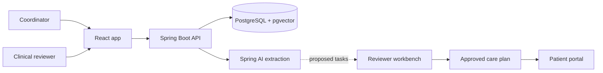

# CareBridge

**Post-discharge care coordination.** CareBridge gives discharge coordinators one workspace to assemble a follow-up plan, assign tasks, and turn complex discharge text into a clear checklist that a clinician reviews before anyone else sees it.

> **Status:** early development, following a 12-week roadmap (see below). CareBridge is educational coordination software that uses **synthetic patients only**. It is not a clinical decision support tool, an EHR integration, or a certified or HIPAA-compliant product.

## The problem

After a patient leaves the hospital, the practical follow-up work is scattered across email and spreadsheets:

- booking follow-up visits
- arranging transport
- clarifying the medication list
- keeping family and caregivers informed

CareBridge brings this into one plan with clear task owners. AI helps pull action items out of discharge text, but a clinical reviewer approves every item first. It never diagnoses, triages or changes medications.

## Who it's for

- **Discharge coordinators:** own the plan and assign tasks
- **Clinical reviewers:** approve or correct AI-proposed tasks and summaries
- **Patients and caregivers (demo):** see only approved tasks
- **System admins:** manage configuration and the audit trail

## Demo workflow

1. Open synthetic patient "Case 008"
2. Upload invented discharge text
3. Watch proposed tasks appear, each with its source excerpt
4. A reviewer approves "schedule follow-up by Friday" and corrects one due date
5. The coordinator assigns transport to a staff member
6. The patient portal shows only the approved tasks
7. The audit timeline records every step

## Planned features

- Synthetic patient case registry
- Discharge document upload with source tracking
- Care plans with task assignments and owners
- AI extraction of follow-up actions as *proposed* tasks, linked to source text
- Reviewer workbench to approve, correct or reject each item
- Plain-language summaries generated only from approved facts
- Flags for missing details, such as a follow-up with no date
- Patient and caregiver portal showing only approved tasks
- Optional FHIR adapters using synthetic fixtures
- Full audit trail of task changes

## Tech stack

| Layer | Technology |
|---|---|
| Frontend | React, TypeScript |
| Backend | Java, Spring Boot, Spring Security, Spring Data JPA |
| AI integration | Spring AI |
| Database | PostgreSQL with pgvector |
| Cache | Redis |
| Interoperability | Optional FHIR fixture adapters |
| Local environment | Docker Compose |

## Architecture

## Design rules

- No AI-generated content reaches a patient-facing plan without approval.
- Every approved fact links back to its source text.
- Every task change is audited.
- Patients can never see another patient's data.
- No diagnoses, triage or medication changes, ever.
- No real patient data or PHI in any public instance.

## Roadmap

| Weeks | Focus |
|---|---|
| 1–2 | Research, design and local setup; identity, roles and assignment rules |
| 3–5 | Synthetic case registry, document ingestion with provenance, care plans and assignments |
| 6–8 | AI extraction with a mock integration, reviewer workbench, patient portal and staging |
| 9–10 | Summaries from approved plans, interoperability and reporting |
| 11–12 | Security, resilience and operations; release and case study |

## Getting started

Setup instructions will be added once the first services are in place.
