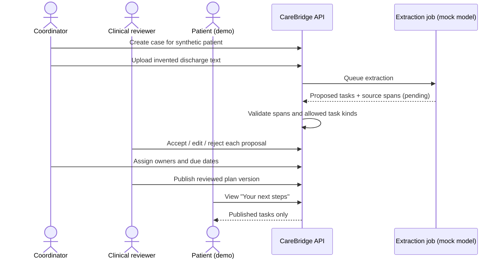
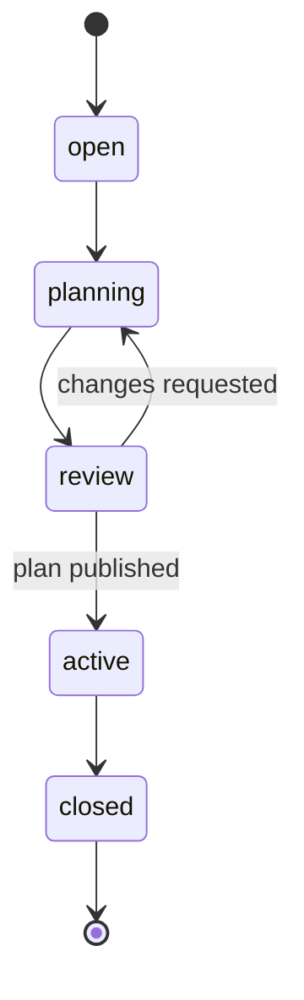
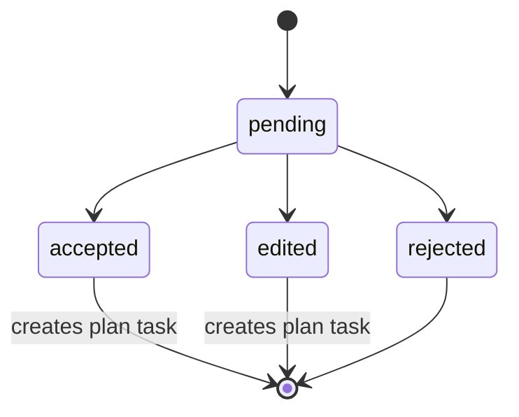
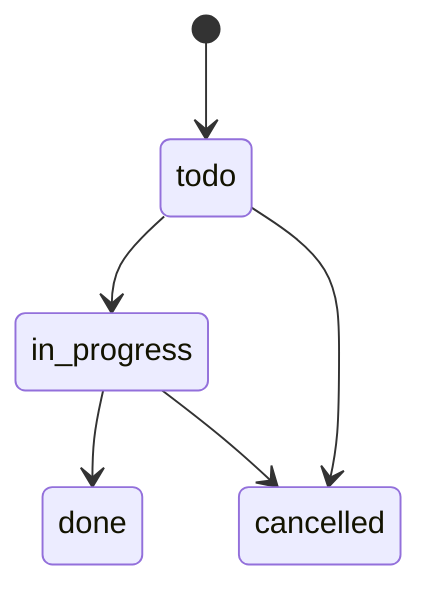

# Workflows

All examples use synthetic data.

## End-to-end discharge follow-up

## Case lifecycle

Shortcuts such as `open → active` are rejected by the API.

## Proposal lifecycle

An accepted or edited proposal creates an independent plan task in the same transaction. A proposal whose source span no longer matches its document hash cannot be approved.

## Task lifecycle

Every transition writes an audit event with actor, time and before/after hashes.

## What each role sees

| Item | Coordinator | Reviewer | Patient (demo) |
|---|---|---|---|
| Pending proposals | ✅ | ✅ | ❌ |
| Rejected proposals | ✅ | ✅ | ❌ |
| Draft plan | ✅ | ✅ | ❌ |
| Published plan | ✅ | ✅ | ✅ own case only |
| Audit timeline | ✅ own unit | ✅ own unit | ❌ |
